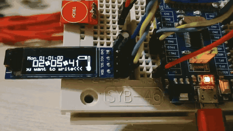

# STM32F030 Clock & Ticker

English | [Русский](README.ru.md)

Firmware for an **STM32F030F4Px** microcontroller with a **128×32 SSD1306 OLED**. In the normal clock view it displays the RTC date and time with a smoothly scrolling ticker and blinking time separators, and uses low-power idle between updates.

[▶ Watch the current demo](https://raw.githubusercontent.com/Lendlav/demo-clock-stm32f0/master/Demo.mp4) · [Original demo on YouTube](https://youtu.be/x5GeTt9Zqug)

[](https://raw.githubusercontent.com/Lendlav/demo-clock-stm32f0/master/Demo.mp4)

The project uses CMake, the STM32 HAL, CMSIS, and FreeRTOS. Its application logic is separated from MCU-specific code so clock formatting does not depend on the hardware or RTOS.

## What it does

- Reads date and time from the STM32 RTC.
- Renders the clock on a 128×32 SSD1306 display over I²C.
- On the clock screen, scrolls the ticker one pixel every 50 ms and blinks the time separators every 500 ms.
- Animates a demo battery gauge in the top-right corner; it is not a battery measurement.
- Shows the STM32's internal die temperature only as a vertical thermometer gauge on the right edge, sampled every 5 seconds.
- Measures the MCU supply voltage from VREFINT and shows it in the settings menu.
- Adjusts OLED brightness from the buttons; the chosen level is not saved and returns to its default after reset or power-off.
- Shows a walking character and a rotating, bouncing wireframe cube after the supply-voltage menu item.
- Sends only changed OLED page ranges after the initial frame.
- Uses FreeRTOS tickless idle and the RTC Alarm to enter STM32 STOP mode between updates.
- Sets the RTC date and time with three buttons.

> The RTC uses the internal low-speed oscillator (LSI). The firmware reads the RTC calendar but does not set its initial date or time.

## Project structure

| Directory | Contents |
| --- | --- |
| `Domain/` | Clock and date data types, independent of hardware and RTOS. |
| `Application/` | Hardware-independent clock formatting, ticker timing, and animation state. |
| `Platform/STM32F0/` | Startup, HAL configuration, RTC/display adapters, and FreeRTOS tasks. |
| `Drivers/` | STM32 HAL and CMSIS device support. |
| `ThirdParty/FreeRTOS/` | FreeRTOS kernel and GCC Cortex-M0 port. |
| `cmake/` | GNU Arm toolchain configuration for CMake. |

The clock task samples the RTC and sends frames through a one-item FreeRTOS queue; the display task draws the newest frame. The animation advances at 20 frames per second. During idle between frames, the firmware stops SysTick, enters STOP mode with the low-power regulator, and uses an RTC subsecond alarm to wake near the next update. It restores the PLL and accounts for elapsed RTC time before resuming FreeRTOS.

The thermometer and supply reading share the STM32F030's internal ADC measurement and factory VREFINT calibration. The thermometer visualizes MCU die temperature; it is not an ambient-temperature sensor. The voltage shown is the MCU supply estimate, not a battery measurement.

## Power-saving behavior

- On the clock screen, the ticker moves one pixel per frame and the time separators blink. The animated battery gauge is decorative and does not report supply voltage.
- OLED brightness can be adjusted in 16 steps; unchanged display pages are not retransmitted.
- The STM32F030F4/x6 RTC wake-up timer is unavailable, so tickless STOP uses Alarm A's subsecond comparison instead.
- The OLED stays on to keep the current clock or animation screen visible. Its default contrast is intentionally dim to limit display current.

The firmware reduces MCU activity and OLED brightness, but it does not measure total board current. The OLED module, its regulator, indicator LEDs, and a connected ST-Link can affect a supply-current measurement.

## Hardware

### OLED display

| OLED | STM32F030 |
| --- | --- |
| SCL | PA9 / I2C1_SCL |
| SDA | PA10 / I2C1_SDA |
| VCC, GND | Connect according to the display module's specifications; use 3.3 V logic. |

The firmware is configured for an SSD1306 128×32 display. Make sure the module's I²C pull-ups are suitable for 3.3 V.

### ST-Link SWD

| ST-Link | Target board |
| --- | --- |
| SWDIO | SWDIO |
| SWCLK | SWCLK |
| GND | GND |
| VTref / 3.3 V sense | Target 3.3 V reference |

Power the target board and connect a common ground. VTref is a voltage reference input on many ST-Link adapters; check your adapter before using any pin marked `3.3 V` as a power output.

### Clock setting buttons

Connect normally-open buttons between the listed GPIO pins and GND. The firmware enables internal pull-ups, so no external resistors are needed.

| Button | STM32F030 |
| --- | --- |
| MODE | PA0 |
| + | PA1 |
| − | PA2 |

Press MODE to cycle through hour, minute, day, month, year, brightness, supply voltage, animation, then return to the normal display. Use + and − to change the selected value; holding either button repeats the adjustment. RTC changes are written immediately. Brightness is adjustable in 16 levels; the supply voltage and animation are read-only. A walking character and a rotating cube move across the display, replacing the clock view until MODE is pressed again.

## Prepare the build and flash tools

On Debian or Ubuntu, install CMake, the GNU Arm Embedded toolchain, Make, and ST-Link utilities. CMake configures the build; on a typical Linux setup, `cmake --build` invokes the generated Makefiles.

```sh
sudo apt install \
  cmake build-essential \
  gcc-arm-none-eabi binutils-arm-none-eabi libnewlib-arm-none-eabi \
  stlink-tools
```

Check that the commands are available:

```sh
cmake --version
arm-none-eabi-gcc --version
arm-none-eabi-objcopy --version
st-flash --version
```

Package names can differ on other Linux distributions. Install equivalent CMake, GNU Arm Embedded, Make, and ST-Link packages there.

## Build

From the repository root, configure and build the firmware:

```sh
cmake -S . -B build \
  -DCMAKE_TOOLCHAIN_FILE="$PWD/cmake/arm-none-eabi.cmake" \
  -DCMAKE_BUILD_TYPE=Release
cmake --build build --parallel
```

The generated files are placed in `build/`:

| File | Use |
| --- | --- |
| `demo-clock.elf` | Debugging and symbol information. |
| `demo-clock.hex` | Intel HEX firmware image. |
| `demo-clock.bin` | Raw binary image used by the ST-Link command below. |
| `demo-clock.map` | Linker memory and symbol map. |

The linker configuration targets the STM32F030F4 memory layout: **16 KiB Flash** and **4 KiB RAM**.

## Flash with ST-Link

1. Connect the ST-Link to the target's SWDIO, SWCLK, GND, and target-voltage reference pins. Power the board.
2. Confirm that ST-Link can see the programmer and MCU:

   ```sh
   st-info --probe
   ```

3. Build the firmware if you have not already, then program the binary and reset the MCU:

   ```sh
   st-flash --reset write build/demo-clock.bin 0x08000000
   ```

`st-flash` writes the binary at the start of the STM32 internal Flash. The `--reset` option resets the target after programming, so the application starts immediately.

If the probe cannot connect while the application is running, retry with the target held in reset during connection:

```sh
st-flash --connect-under-reset --reset write build/demo-clock.bin 0x08000000
```

### Troubleshooting

- **No programmer or target found:** check the USB cable, target power, common GND, SWDIO/SWCLK wiring, and ST-Link permissions. Try `--connect-under-reset` if normal SWD connection fails.
- **OLED stays blank or is too dim:** verify 3.3 V power, ground, SDA on PA10, SCL on PA9, and that the module is an SSD1306 128×32 I²C display. Use MODE to select brightness and press + to increase it.
- **Date or time is unexpected:** the firmware does not initialize the RTC calendar at boot. Use MODE, +, and − to set the date and time.

## License notices

The bundled FreeRTOS V9.0.0 kernel is distributed under GPLv2 with the FreeRTOS exception; see [`ThirdParty/FreeRTOS/LICENSE.txt`](ThirdParty/FreeRTOS/LICENSE.txt). The GCC Cortex-M0 port has a separate MIT license notice in its source. Bundled CMSIS and STM32 HAL/device-support files retain their original notices in their source headers. Include applicable third-party notices when redistributing firmware binaries. No project-wide license is declared for the project's own code.
